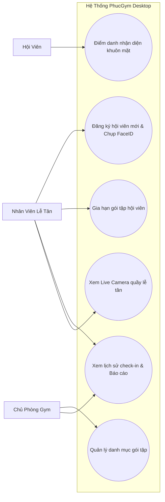
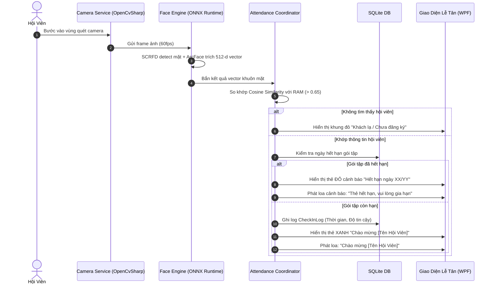
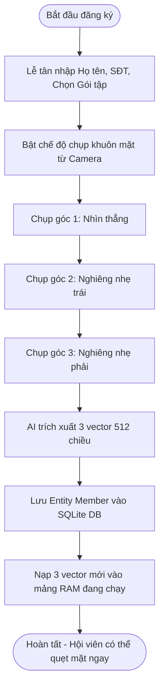
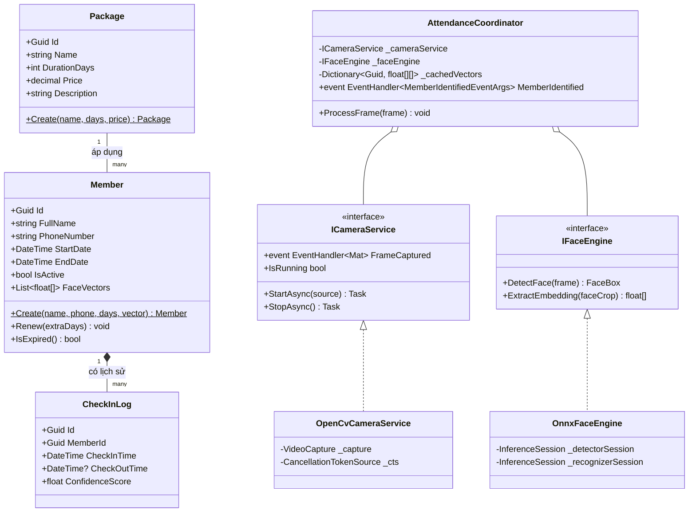
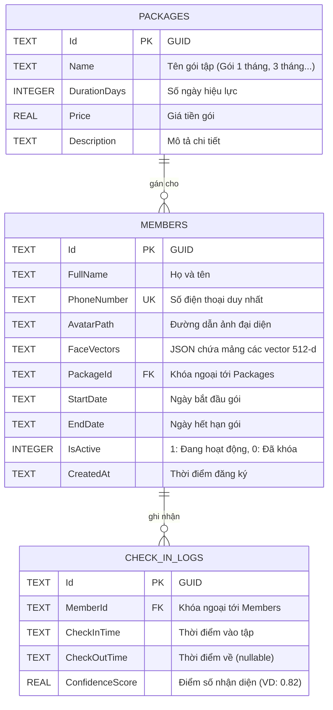

# TỔNG HỢP SƠ ĐỒ THIẾT KẾ — PHUCGYM DESKTOP (.NET 10 STANDALONE)

Tài liệu thiết kế bao gồm: Use Case, User Flow (Điểm danh & Đăng ký), Sơ đồ Lớp OOP (Class Diagram), và Sơ đồ CSDL (ERD).

---

## 1. SƠ ĐỒ USE CASE CƠ BẢN (USE CASE DIAGRAM)

---

## 2. USER FLOW (LUỒNG THAO TÁC NGƯỜI DÙNG)

### 2.1 Luồng Điểm danh tự động bằng FaceID (Tốc độ < 70ms)

### 2.2 Luồng Đăng ký Hội viên mới & Chụp Multi-Template FaceID

---

## 3. SƠ ĐỒ LỚP HƯỚNG ĐỐI TƯỢNG (OOP CLASS DIAGRAM)

---

## 4. SƠ ĐỒ CƠ SỞ DỮ LIỆU (DATABASE ERD - SQLITE)

